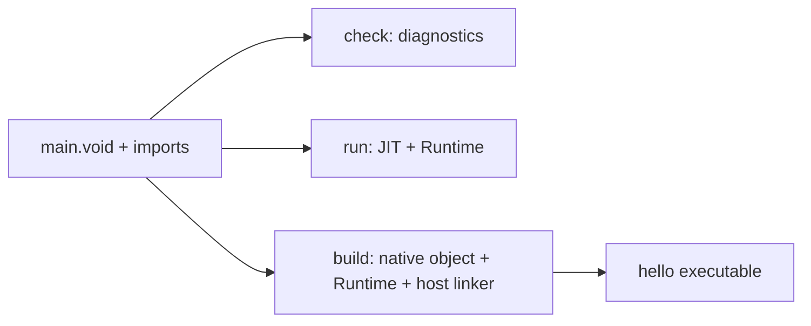

# Your first VOID program

[Install the tools](install/README.md), add their `bin` directory to PATH and
confirm `voidc --version`. Generate a project and open its starter source:

```sh
voidc new "Hello Project" --source src/hello.void
cd "Hello Project"
```

Replace the contents of `src/hello.void` with this program.

```void
use console

func main() -> i32:
    print("Hello, world!")
    return 0
```

This is also available as [examples/hello/main.void](../examples/hello/main.void).
`use console` imports the matching installed standard source. `print` writes a
newline. `main` returns the process status; returning zero itself prints nothing.

From that directory:

```sh
voidc check --project . --profile debug
# Source checked successfully
voidc run --project . --profile debug
# Hello, world!
voidc build --project . --profile release -o hello
# Built native executable: hello
./hello
# Hello, world!
```

On Windows use `-o hello.exe` and `.\hello.exe`. A path with spaces must be quoted.
The default output for this project is `build/hello` (`build/hello.exe` on Windows).
Output paths are relative to your shell's directory unless absolute.

In VS Code, open **Hello Project** as a trusted folder. Save changes and use
**VOID: Check Project**, **VOID: Build Project**, or **VOID: Run Project**.
Compiler diagnostics appear in Problems. A file you open in the project can
receive editor assistance before you import it into the application.
[VS Code project commands](EDITOR_INTEGRATION.md#vs-code-project-commands)



The manifest selects a unique supported synchronous `main` in any filename
under its source roots. For a standalone source, pass its file path directly.
A manifestless directory still selects exact-case `main.void`. `check` analyzes
source without running startup code.

Try changing the printed message, then run and build again. If an application
returns 7, both the JIT and native application exit 7; that number is not printed.
The historical `entry(i32) -> i32` adapter instead prints a numeric result and
exits zero. See [CLI commands](CLI.md), [language examples](../examples/),
[types](NUMERIC_TYPES.md) and [editor setup](EDITOR_INTEGRATION.md).

## Step through a native Debug build

On Linux x64 or Windows x64, append the following table to `void.project.toml`.

```toml
[build.debug]
debug_info = "full"
```

Replace `src/hello.void` with this program.

```void
func doubled(input: i32) -> i32:
    var answer = input * 2
    return answer

func main() -> i32:
    return doubled(7)
```

Run `voidc build --project . --profile debug`. On Linux, open
`build/hello` in LLVM 23.1.4 LLDB. Run `settings set target.disable-aslr false`
and `breakpoint set -f hello.void -l 2`, then `run`, `next`, and
`frame variable answer`. On Windows, open
`build\hello.exe` in native GDB and run `break hello.void:2`, `run`,
`next`, and `print answer`. The initialized value is 14. Use `continue`
to finish and observe the application exit status.
[VS Code launch and native debugger setup](EDITOR_INTEGRATION.md#native-aot-source-debugging)
