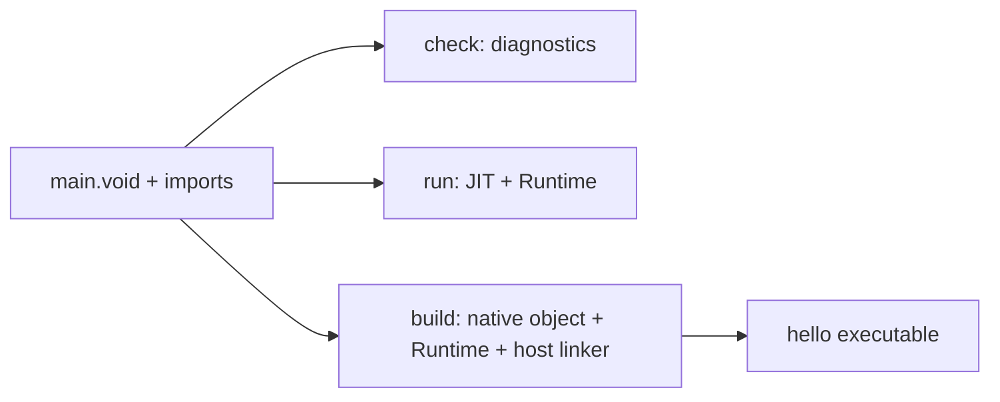

# Your first VOID program

[Install the tools](install/README.md), add their `bin` directory to PATH and
confirm `voidc --version`. Create a new directory and save `main.void` inside it:

```void
use console

func main() -> i32:
    print("Hello, world!")
    return 0
```

This is also available as [examples/hello/main.void](../examples/hello/main.void).
`use console` imports the matching installed standard source. `print` writes a
newline. `main` returns the process status; returning zero itself prints nothing.

From that directory:

```sh
voidc check .
# Source checked successfully
voidc run .
# Hello, world!
voidc build . -o hello
# Built native executable: hello
./hello
# Hello, world!
```

On Windows use `-o hello.exe` and `.\hello.exe`. A path with spaces must be quoted.
The default `voidc build .` output is `build/main` (`build/main.exe` on Windows).
Output paths are relative to your shell's directory unless absolute.



Entry selection is automatic: use a supported synchronous `main` or executable
top-level statements. Do not combine competing entry styles. Directories select
exact-case `main.void`; explicit file paths can use another filename. `check`
analyzes without running startup or requiring an application entry.

Try changing the printed message, then run and build again. If an application
returns 7, both the JIT and native application exit 7; that number is not printed.
The historical `entry(i32) -> i32` adapter instead prints a numeric result and
exits zero. See [CLI commands](CLI.md), [language examples](../examples/),
[types](NUMERIC_TYPES.md) and [editor setup](EDITOR_INTEGRATION.md).
