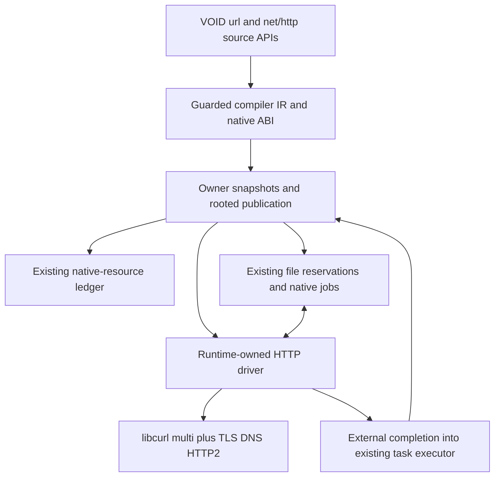

# HTTP client architecture research

## Current authorization and inventory correction, 30 October 2026

Boss has approved the researched architecture and the full initial `url` and
`net/http` contract, superseding the five pending owner decisions in the original
report below. [Authorization](AUTHORIZATION.md) adds mandatory task-result lifetime,
external completion/shutdown, shared libcurl process lifetime and real-memory
accounting corrections. [Engineering status](IMPLEMENTATION.md) records actual
work; approval does not mean implementation or acceptance.

In-memory cookie sessions are approved. Persistent cookie storage and cookie
import/export are excluded. The original completeness inventory's phrase
"checked import/export" contradicted DESIGN section 7 and was erroneous; the
corrected row below includes session cookies only. Enumeration needed for native
jar accounting is an internal safety operation, not a public export API.

The original research-only status, experiments-not-run statement and pending
decisions below describe the report when written. Keep their historical context;
they do not withdraw the subsequent Boss engineering authorization.

## Original research report

Status: **proposal for Golden Wrench review and Boss approval; no implementation**.
Reviewed 30 October 2026 at `15f7868b0af177f8f7d49c548392c79c7bd921d2`.
The compiler pins LLVM/Clang/LLD **23.1.4**. Older handoff toolchain pins and
historical future-feature statements are not current implementation facts.

Read with [proposed contract](DESIGN.md) and [engineering roadmap](ROADMAP.md).
No HTTP requests, builds, tests, native experiments, Git mutations or hosted CI
were run for this research. Findings below distinguish source evidence from
engineering proposals and dependencies requiring experiments.

## Recommendation and important limits

Use **libcurl's multi interface** for HTTP transport, HTTP/2 through nghttp2,
platform-appropriate maintained TLS, and libcurl's URL parser. Keep a small public
`url` facade separate from `net/http`. HTTP does not require public `net/tcp`,
`net/udp` or TLS modules. Neither an HTTP parser nor cryptography belongs in VOID
source. Source wrappers should own convenience APIs, validation and error mapping;
the Runtime should own transport handles and native memory.

Three dependencies prevent an honest claim that an easy wrapper is enough:

1. The existing native-job API occupies one source-worker slot until `execute`
   returns. Streaming requests waiting for source-produced data can exhaust that
   pool and prevent their own file producers from running. Use one private native
   network driver per Runtime and extend the existing completion handoff to
   accept externally completed jobs. This is a justified scheduler integration,
   not a second source scheduler or general event-loop framework.
2. A small wrapper buffer is not a bound on libcurl's memory. Paused HTTP/2 streams
   retain transport-window data. Automatic decompression plus pause can retain
   much more. Receive encoded bytes, apply bounded incremental decoding, limit
   active transfers/connections, and account for the pinned transport's windows.
3. VOID retains completed **task results** until root drain. Repeated async chunk
   reads can retain every returned chunk. Native bulk file transfers must avoid
   source tasks per chunk. General long-running pull streaming still needs an
   approved bounded-result-lifetime solution or an explicit scope qualification.
   Do not sell bounded network buffers as bounded application memory.

Recommend HTTP/1.1 and HTTPS HTTP/2 in the initial contract. HTTP/3 is a proposed
explicit exclusion, requiring Boss approval; it is not silently scheduled later.
The same applies to the other exclusions enumerated in DESIGN.md. No HTTP
engineering is authorized by this report.

This is the proposed reuse boundary; external completion and HTTP resources are
new work, not currently implemented facilities:

## Current source audit

Line anchors refer to this baseline, not future edited files.

| Area | Verified current infrastructure | Consequence for HTTP |
| --- | --- | --- |
| Toolchain/build | `CMakeLists.txt:1–18,99–109`; exact LLVM 23.1.4, C++20, Threads; Runtime archive; Windows static CRT contract | Match CRT/architecture/configuration for dependencies. No existing curl/TLS target. |
| Modules/VFS | `src/frontend/compiler.cpp:4940–5150,6464–6530`; existing canonical stdlib/project identities, import discovery and editor assistance | Add ordinary `stdlib/net/http.void` and, if approved, `stdlib/url.void`; never a second editor catalogue. Neither exists now. |
| Earlier networking direction | `VOID_STDLIB_AND_GLOBAL_VARS_WRENCH_HANDOFF_2026-10-24.md`, section 12 | Distinct HTTP/TCP/UDP modules, easy sync and `_async` HTTP APIs. Its example is a direction, not an implementation. |
| Standard wrappers | `stdlib/io.void:62–86,362–473,481–502`; `stdlib/error.void`; `stdlib/os.void:36–52` | Shared managed errors, private factories, cleanup guards and explicit native error domains already exist. |
| Private compiler bridge | `include/void/filesystem_ops.hpp`; `src/frontend/filesystem.inc`; `src/frontend/compiler.cpp:3101–3109`; `src/ir/filesystem.inc` | Existing bridge is exact-module and exact-shape guarded, not general FFI. HTTP needs a narrow admitted bridge and independent IR checks. Do not pass HTTP operations through filesystem opcodes. |
| LLVM/ABI | `src/backend/llvm/filesystem.inc:11–41`; `src/runtime/filesystem_abi.cpp:124–193,298–366` | Reuse descriptor/layout generation, offset validation, rooted publication and owned snapshots; never expose CURL pointers or rely on handwritten managed offsets. |
| Native jobs | `include/void/async.hpp:37–55`; `src/runtime/async.cpp:105–158,184–220,537–562` | Owned native execute/abandon off owner; rooted managed publish on owner; release/acquire completion. External completion is **missing**. |
| Native resources | `include/void/native_resource.hpp`; `src/runtime/native_resource.cpp:8–32,70–115` | One Runtime ledger, owner-thread calls, persistent wrapper Handle, shutdown cleanup. GC is not deterministic disposal; dropping a wrapper does not immediately close. |
| File reservations | `src/runtime/filesystem_abi.cpp:40–111,195–290`; `stdlib/io.void:379–410` | Reuse one-operation claims, descendant activation ownership, busy errors and acquisition rollback for file helpers; network code cannot steal raw handles or change cursor authority. |
| Shutdown | `src/runtime/coordination.cpp:311–325,334–361` | Closing rejects new work and waits for native jobs **before** ledger shutdown. An HTTP stop/wakeup must occur before that wait, otherwise waiting transfers can deadlock shutdown. |
| Async semantics | `ASYNC.md`; `src/runtime/async.cpp:355–397,432–464` | Structured parent/group drain, cancellation distinct from Err, cleanup shielding, no detach. Existing semantics must survive external completion. |
| Result retention | `src/runtime/async.cpp:43–77,81–85,252–263`; `STAGE8_ASYNC_RETENTION.md`, ownership proof | Task owns result Handle; scope owns task records/index. Completed frames retire, results do not. A group exit alone does not solve retained chunks. |
| Application entry | `src/main.cpp:61–88`; `tests/io/runner.cpp:69–80`; `ASYNC.md`, explicit root adapter | CLI calls synchronous compile/build. Async is usable through existing `compile_async` / `emit_async_object` host adapters, not an implemented automatic async main. Do not invent syntax or promise CLI async. |
| Globals/workers | `RUNTIME_GLOBALS.md`; `src/ir/module.cpp:1451–1477` | Explicit clients may be stored in ordinary globals/fields; mutable state remains owner-only. Source workers cannot perform native HTTP or transfer clients/resources. |
| Bytes/UTF-8/JSON | `stdlib/io.void:1340–1353,1419–1434`; `stdlib/json.void:602,1089–1116`; `stdlib/encoding/*`; `stdlib/collections.void` | Reuse `[u8]`, strict `string.from_utf8`, `to_utf8`, JSON parse/stringify and ordinary collections. No parallel JSON or text codec system. |
| Documentation/LSP | `DOCUMENTATION_HOVER.md`; existing declaration metadata and `tests/io/lsp.py` | Public `##`, `@param`, `@return`, compiler completion, hover, signature help and navigation. No editor HTTP parser. |
| Test/evidence | `tests/io/{runner.cpp,execution.py,native_jobs.cpp,ownership.cpp,preservation.py}`; `tests/text_encoding/crash.py`; `tools/test_platform.py` | Reuse JIT/O2/AOT runners, allocation/GC barriers and crash preservation. Real 1 MiB tests query/enforce child stack, not an unverified shell setting. |

The Language Bible's arrays, dictionaries, callbacks, lifecycle, async and error
sections were checked against these implemented contracts. Dictionaries cannot
represent repeated header/query names; ordered arrays can. There is no need for
function overloads, async function-value parameters, reflection, a public task
type, implicit coercions or a new collection engine.

## Transport comparison

| Candidate | Strength | Missing work / risk for this mission | Assessment |
| --- | --- | --- | --- |
| libcurl multi | C ABI; URL parser; HTTP/1.1/2, optional 3; TLS backends; proxies/auth/cookies/MIME; connection cache; pause/wakeup | Runtime integration, resource limits, validation, bounded decoding and platform packaging still necessary | **Recommended**; one maintained transport on three platforms |
| Boost.Beast + Asio + TLS | Strong typed low-level HTTP/1 and asynchronous sockets | Beast explicitly provides protocol building blocks; VOID would build redirect/cookie/proxy/pool behavior and obtain HTTP/2 separately | More architecture and C++ template cost for this contract |
| cpp-httplib | Small, approachable, maintained client/server interface | Upstream explicitly documents blocking sockets and HTTP/1.1 only | An `_async` worker wrapper would not deliver the selected transport contract |
| WinHTTP + URLSession + Linux provider | Native platform integration/trust, native async services | Three transport adapters with different redirect/auth/cookie/proxy/lifecycle semantics and acceptance suites | Valid alternative if native enterprise integration dominates; not the smallest shared architecture |
| Raw sockets + TLS/nghttp2 directly | Maximum control | Rebuilds substantial HTTP policy, parsing and pooling; many security responsibilities | Reject for this mission |

Primary references: [libcurl multi](https://curl.se/libcurl/c/libcurl-multi.html),
[Beast's stated abstraction](https://www.boost.org/doc/libs/latest/libs/beast/doc/html/beast/design_choices/faq.html),
[Beast protocol scope](https://www.boost.org/library/latest/beast/),
[cpp-httplib's documented limits](https://github.com/yhirose/cpp-httplib#readme),
[WinHTTP](https://learn.microsoft.com/en-us/windows/win32/winhttp/about-winhttp),
[URLSession](https://developer.apple.com/documentation/foundation/urlsession).
Apple's page was JavaScript-only in the available reader; no detailed URLSession
feature-parity claim is based on unread content. Its suitability needs a separate
platform audit if Boss selects that alternative.

## Dependency and platform findings

The official [release table](https://curl.se/docs/releases.html) identifies curl
8.23.0, released 14 October 2026. It is a **research candidate**, not a pin installed
or tested by this mission. Engineering must choose exact maintained versions,
checksums, compatible options and security disposition for the whole dependency
closure before coding. Do not use ambient `curl.exe` or shell out to curl.

Recommended transport composition:

| Component | Linux | Windows | macOS |
| --- | --- | --- | --- |
| HTTP | Same pinned libcurl and nghttp2 | Same, matched static CRT | Same, matched deployment target/architecture |
| TLS | Maintained OpenSSL, configured distribution trust locations | Schannel, native Windows CA store | OpenSSL plus libcurl Apple SecTrust support, native keychain trust |
| DNS | c-ares candidate | c-ares candidate | c-ares candidate; VPN/split-DNS acceptance is essential |
| IDN | libidn2 | WinIDN | Apple IDN |
| Cookies | libpsl-enabled libcurl and versioned PSL data | Same | Same |
| Content decoding | Bounded zlib gzip/deflate adapter | Same | Same |

These combinations are supported in upstream configuration, not native VOID
acceptance results. [curl 8.23 CMake](https://github.com/curl/curl/blob/curl-8_23_0/CMakeLists.txt)
explicitly has Schannel, Apple SecTrust, Windows/Apple IDN and libpsl choices.
[Certificate documentation](https://curl.se/docs/sslcerts.html) distinguishes native
Windows/Apple trust from other backends' file-based trust. A CA bundle discovered
through cwd/PATH is not an acceptable VOID trust policy.

DNS is a real choice, not just a feature flag. With `NOSIGNAL=1`, a synchronous
resolver can exceed DNS timeouts. A threaded resolver preserves native resolution
better, but cancelling a lookup need not stop its underlying OS call. c-ares gives
asynchronous cancellable queries, but must be tested for hosts/search domains,
enterprise split DNS, local names, IPv6 and sandbox configuration. It is not
equivalent to every NSS/OS resolver plugin. Recommend c-ares for predictable
transport cancellation, with this compatibility boundary explicitly approved.
References: [NOSIGNAL](https://curl.se/libcurl/c/CURLOPT_NOSIGNAL.html),
[thread safety and DNS](https://curl.se/libcurl/c/threadsafe.html),
[c-ares cancellation](https://c-ares.org/docs/ares_cancel.html).
VOID must let libcurl own its resolver channels; cancelling one request must not
call a channel-wide cancellation API on unrelated transfers.

IDN behavior is also not identical: upstream documents IDNA2008 for libidn2 and
transitional processing for WinIDN. Expose the actual normalized ASCII host and
provider in capabilities; compare origins using that result, not Unicode visual
similarity. Do not promise browser-equivalent parsing or identical international
host mapping across platforms. [curl URL syntax](https://curl.se/docs/url-syntax.html).

### Distribution, linking and maintenance

Use upstream imported CMake targets and explicit selected roots, not a new package
manager. [FindCURL](https://cmake.org/cmake/help/latest/module/FindCURL.html) provides
`CURL::libcurl`; its current documentation also contains additions newer than
VOID's CMake minimum. Prefer the upstream config package and a small configure
probe that checks the selected build's actual feature/backend identity.

`cmake/NativeBuild.cmake:1–51` currently installs two Runtime archives and emits
their paths/platform flags into `void-native.txt`. Adding a CMake transitive link
alone does **not** make independently linked `voidc build` work. Both this manifest
route and existing external native-host tests must carry the exact dependency
closure, architecture, CRT, frameworks and system libraries. Preserve current
Unicode/long-path staging, checked transfer and atomic executable publication.
Extend existing validated manifest handling only where necessary; do not redesign
native staging or use cwd search as dependency discovery.

Static libcurl/nghttp2/zlib and an appropriate TLS build are practical candidates;
they do not make Linux libc, DNS configuration or CA trust self-contained.
Dynamic Linux distribution libraries can receive security updates without
rebuilding each game, but deployment must declare versions and loader paths.
Windows/macOS bundled libraries need explicit secure loading/signing/install-name
handling if dynamic. Avoid accidentally exporting or colliding with an embedder's
other libcurl/OpenSSL instance. No universal-static or cross-compilation promise
is established here.

Sandbox permissions remain the application's packaging responsibility. Apple's
[outgoing-client entitlement](https://developer.apple.com/documentation/BundleResources/Entitlements/com.apple.security.network.client)
governs sandboxed outbound connections;
[Flatpak network permission](https://docs.flatpak.org/en/latest/sandbox-permissions.html)
and [Windows AppContainer capabilities](https://learn.microsoft.com/en-us/windows/win32/secauthz/appcontainer-isolation)
also affect access. Do not grant inbound/server privileges for a client module,
change firewall/entitlements from Runtime, or treat denied sandbox access as a
reason to disable TLS. Native acceptance must include allowed and denied outbound
access plus access to configured CA/client-identity files. Ordinary desktop support
does not establish App Store/UWP/console certification.

Upstream licenses: [curl-specific permissive license](https://curl.se/docs/copyright.html),
[nghttp2 MIT](https://github.com/nghttp2/nghttp2#license),
[c-ares MIT](https://c-ares.org/license.html), [zlib](https://zlib.net/zlib_license.html),
[libpsl MIT](https://github.com/rockdaboot/libpsl/blob/master/LICENSE),
[modern OpenSSL Apache-2.0](https://github.com/openssl/openssl/blob/master/LICENSE.txt).
Record the exact chosen releases' notices, PSL data license and all transitive
IDN/Unicode libraries. The inspected [libidn2 public library header](https://gitlab.com/libidn/libidn2/-/blob/master/lib/idn2.h.in)
offers LGPL-3.0-or-later or GPL-2.0-or-later; the top-level GPL COPYING file alone
is insufficient evidence for the library's license choice. Resolve the selected
release's LGPL terms, dependency closure and static relinking obligations before distribution;
do not label the entire closure permissive or approved for a closed game. Boss
must select the deployment policy after that exact inventory. No legal clearance
is claimed by this engineering research.

Security maintenance is part of ownership: track curl/TLS/resolver/nghttp2/PSL
advisories, pin reproducible source/options, retain dependency manifests in private
package evidence, and rerun affected integration tests when updating. The compiler
and installed Runtime must agree on ABI/build identity. This does not authorize
automatic downloads at application startup.

Cache integration reuses `CMakeLists.txt:218–237` and
`cmake/CacheBuildIdentity.cmake`: include the selected dependency artifacts/options
in the existing build identity inputs rather than inventing another cache key or
allowing a replaced shared transport library to reuse unidentified cached ABI.

## Findings that materially affect the architecture

### Streaming, multiplexing and decompression

libcurl's [pause contract](https://curl.se/libcurl/c/curl_easy_pause.html) says a
paused write callback has accepted **none** of the offered bytes; those bytes can
be replayed. It also documents internal HTTP/2 buffering and decompression growth.
Unpause may synchronously reenter callbacks. The driver must use whole-chunk
accept/reject, preserve state during reentry and avoid source callbacks.

The inspected [8.23 HTTP/2 implementation](https://github.com/curl/curl/blob/curl-8_23_0/lib/http2.c#L51-L78)
contains 16 KiB chunks, a 10 MiB maximum stream window, a larger aggregate
connection window and spare pools. Thus `CURLOPT_BUFFERSIZE=65536` is not a hard
memory cap. Its own [documentation](https://curl.se/libcurl/c/CURLOPT_BUFFERSIZE.html)
calls that size a request. Configure admission limits and budget the exact
version's connection, stream, TLS, header and decoder allocations. Measure a
paused stream alongside a fast stream; successful small downloads prove none of
this. No specific total-RSS cap has been established by a native experiment here.

Use libcurl transfer framing but disable automatic **content** decoding. Advertise
only selected codecs and decode incrementally from a bounded encoded queue into
a bounded decoded queue. The [zlib stream API](https://zlib.net/manual.html) allows
bounded input/output progress without whole-body allocation. Decode gzip and
zlib-wrapped deflate; explicitly document raw-deflate interoperability rather
than silently guessing. Reject unsupported encoding in decoded mode, allow raw
mode. Check decoded-byte limits independently from Content-Length. Do not decode
compressed network data as UTF-8 before decompression.

### Async ownership and shutdown

The transport driver must hold only owned C++ data and provider state. It must
never allocate managed objects, dereference movable managed payloads, invoke VOID
callbacks or enter old JIT code. Submission snapshots ordinary options, headers
and bytes on the owner. Publication uses existing rooted managed stores after
acquiring completion. Existing task creation order, repeated-await behavior and
failure/cleanup ordering remain authoritative.

Extend the existing task Work completion path to accept a provider completion
ticket: submit once, cancel/wake, complete exactly once, publish or abandon on the
existing owner path. Ticket lifetime must extend through callback removal and
acknowledged driver quiescence. Do not retain raw `Scope*`/`Task*` in a callback
after root drain. Make cancellation publication allocation-independent once
admitted. Shutdown must stop admissions, notify HTTP before waiting for native
jobs, drain driver completions, release ledger resources, join the driver and only
then release roots/code leases. Existing filesystem jobs keep their present path.

Source evidence supports the need for this integration; no external-completion
patch was designed down to C++ class layout or tested. Wrench must review its
smallest implementation before approval, including wait predicates and abandonment.

### Whole-program bounded memory remains a real gate

At 64 KiB per awaited chunk, 1 GiB can retain approximately 1 GiB of result payload
plus tasks, even with a constant transport queue. This is a source-derived growth
estimate, not a benchmark. Repeated awaits are legal, so clearing all observed
results is incorrect. GC collection alone cannot reclaim persistent result roots.

Recommend a bounded **single-operation native bulk** download/upload path using
existing opened-file reservations/kernel operations. It returns metadata/counts,
not one managed result per chunk. It must not hide a source `await` loop internally.
File work remains off the network pump; reuse a bounded native-job lane, with
explicit admission so a bulk transfer does not require another worker to progress.
If continuous per-chunk pull APIs must also have bounded root memory, approve a
separate narrow task-result retirement dependency first. Prove liveness/handle
identity, repeated awaits and diagnostic order; no new GC or forced task detachment.
The design reports this decision openly instead of claiming it solved.

## Completeness inventory

All rows are **missing for HTTP today**. Existing infrastructure in the second
column is reusable, not evidence that the proposed HTTP feature already works.
Detailed defaults and signatures are in DESIGN.md; matching test IDs in ROADMAP.md.

| Essential capability | Implementation owner / dependencies | Public contract | Verification |
| --- | --- | --- | --- |
| URL parse/resolve/encode/ordered queries | `url` facade + shared CURLU bridge | Valid HTTP(S) authority; explicit normalization; owned UTF-8/bytes | U |
| Methods, duplicates, binary headers | HTTP source types + native validation | Ordered headers, exact method token, no unsafe framing override | H |
| Empty/text/bytes/form/multipart/stream body | Source body types + curl MIME/read adapters | Single ownership snapshot; explicit stream length/EOF | B |
| Status, final URL, headers, history, trailers | Native protocol metadata + source records | Non-2xx is a response; separate status check | H, R |
| Bounded upload/download and file helpers | Driver queues + decoder + existing file claims + bulk jobs | Backpressure, partial progress, no implicit overwrite/atomic download claim | S, F |
| TLS/hostname/trust/client identity | curl TLS backend + native trust | Verification on, TLS >=1.2, no insecure bypass | T |
| DNS, v4/v6, keepalive/pooling | curl multi + approved resolver | Isolated client pools; finite connection lifetime | N |
| Connect/header/read/write/total timeout | curl connect timer + driver monotonic deadlines | Distinct phases, deadline across redirects/queueing | D |
| Actual async/cancellation/shutdown | Existing executor/ledger + external completion | No owner blocking; structured drain, no Err cancellation | A |
| Redirect/replay/credential safety | Native hop controller + same URL parser | Bounded hops; downgrade blocked; no silent secret/replay | R |
| Auth/proxies/cookies | curl auth/proxy/cookie engines + source policy | Explicit secrets/options; scoped bounded in-memory jar; persistent import/export excluded (corrected above) | P, C |
| Compression/text/JSON | Bounded zlib + existing UTF-8/JSON | Explicit raw/decoded, strict text; no duplicate JSON serializer | E |
| HTTP/1.1 and HTTP/2 | curl + nghttp2 + ALPN | Actual negotiated version; strict selected mode | V |
| Native/install/AOT/tooling/stack | Existing manifests/ABI/cache/VFS/LSP/evidence | Matching dependencies and semantic checks on every path | X, L |
| Protocol exclusions and advanced integration | Boss decisions | Listed exclusions never masquerade as implemented capabilities | O |

## What is established and what is not

**Confirmed:** reusable compiler/Runtime facilities above; no HTTP module/transport
in this baseline; worker-completion API shape; retained results; shutdown ordering;
documented curl callback/buffering/security constraints.

**Recommendation, not a measurement:** shared libcurl architecture, driver thread,
external completion, bounded decoding, native bulk jobs, proposed defaults and
HTTP/3 exclusion. They require reviewed engineering and platform validation.

**Unresolved:** exact dependency pins/license closure; native DNS/trust/proxy
compatibility; observed cancellation latency and total memory envelope; general
async pull-result retention; final owner-approved exclusions. No new investigation
establishes a repair for historical H1–H7, DSE or async filesystem crashes.

The baseline documentation index still contains a historical statement that JSON
is not implemented. Actual `stdlib/json.void` and current stabilization source
demonstrate otherwise. This report uses source behavior without editing unrelated
historical entries or claiming new JSON work.
