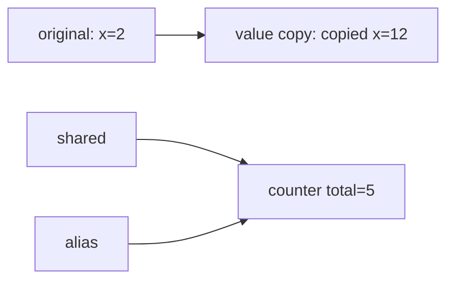

# Copy values and share managed objects

_Draft for Boss approval; repository documentation is canonical._

A `value struct` is copied by value. An ordinary `struct` has managed identity:

```void
value struct point:
    x: i32

struct counter:
    total: i32

func entry(value: i32) -> i32:
    var original = point(x = value)
    var copied = original
    copied.x += 10
    var shared = counter(total = 0)
    var alias = shared
    alias.total += 5
    return original.x + copied.x + shared.total
```

Save as `memory.void`, then run:

```sh
voidc check memory.void
voidc run memory.void 2
# 19
```

The numeric `entry` adapter prints the result and exits zero.

`original.x` stays 2, `copied.x` becomes 12, and `alias` changes the same counter
seen through `shared` to 5. The result is 2 + 12 + 5 = 19.



The Runtime coordinates precise collection and required roots. Managed memory
does not imply unrestricted cross-thread sharing, unbounded resources or automatic
closure of every external resource. Follow the documented ownership/cleanup APIs.

Canonical details: [managed structs](https://github.com/Shmellyorc/Void.Language/blob/main/docs/MANAGED_STRUCTS.md), [value structs](https://github.com/Shmellyorc/Void.Language/blob/main/docs/VALUE_STRUCTS.md), [GC Runtime](https://github.com/Shmellyorc/Void.Language/blob/main/docs/GC_RUNTIME.md).
